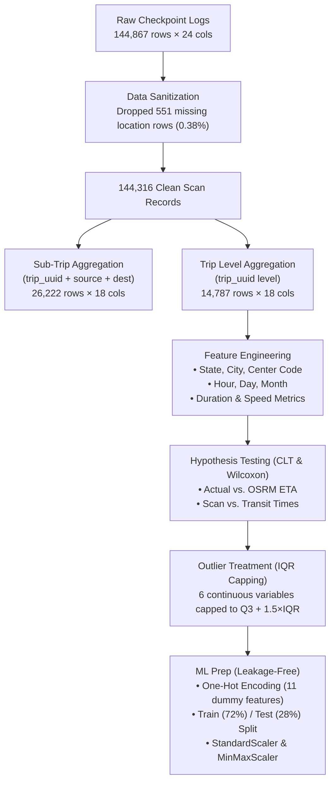

# Delhivery — Logistics Feature Engineering & ETA Analytics

[](mailto:shivalingb09@gmail.com)
[](https://github.com/Hazardous9hub)
[](https://www.python.org/)
[](LICENSE)

<br/>

<div align="center">

[](https://colab.research.google.com/github/Hazardous9hub/Delhivery-Logostics-Feature-Engineering-Analytics/blob/main/notebooks/delhivery-feature-engineering-case-study.ipynb)
[](https://www.kaggle.com/datasets/shivaling09/delhivery-logistics-network-and-route-data)

</div>

> A exploratory data analytics, data cleaning, feature engineering and inferential statistics study transforming 144,000+ raw logistics scan logs into aggregated trip corridors, evaluating OSRM routing engine discrepancies via hypothesis testing, treating outliers, and preparing production-grade features for machine learning.

---

### Tech Stack & Tools

<div align="center">


</div>

---

## 1. Executive Summary

Delhivery operates India's largest parcel transport network. Raw scanner records arrive as nested checkpoint scans rather than end-to-end customer trips. In parallel, Delhivery's routing engine (OSRM) predicts route distances and durations based on ideal road networks, failing to account for ground realities.

### Project Goals
1. **Clean and consolidate** nested checkpoint logs into discrete Origin-Destination trips.
2. **Engineer domain features** from location text, facility codes, and timestamps.
3. **Statistically test** the OSRM routing engine against ground truth delivery times.
4. **Treat operational outliers** through IQR capping without dropping genuine long-haul freight.
5. **Encode and scale features** for machine learning models without data leakage.
6. **Deliver data-backed operational actions** for supply chain leadership.

---

## 2. Pipeline Architecture & Workflow



---

## 3. Data Transformations & Feature Engineering

### 3.1 Aggregations
- **Raw Input**: 144,867 records across 24 columns.
- **Dataset Source**: Hosted on [Kaggle: Delhivery Logistics Network and Route Data](https://www.kaggle.com/datasets/shivaling09/delhivery-logistics-network-and-route-data).
- **Null Filtering**: Removed 551 records (0.38%) lacking both `source_name` and `destination_name`.
- **Hierarchical Rollup**:
  - **Sub-Trip Level**: 26,222 rows grouped by `trip_uuid`, `source_center`, and `destination_center`.
  - **Trip Level**: 14,787 unique end-to-end trips grouped by `trip_uuid`.

### 3.2 Derived Features
- **Geographic Parsing**: Extracted state, city, and center code from raw location strings (`city_place_code (state)`).
- **Freight Corridors**: Constructed corridor keys (`source_state -> destination_state`).
- **Temporal Granularities**: Extracted `trip_year`, `trip_month`, `trip_day`, `trip_day_name`, and `trip_hour` from `trip_creation_time`.
- **Operational Metrics**:
  - `trip_duration_min`: Total trip duration from creation to destination arrival.
  - `start_scan_to_end_scan`: Warehouse dispatch-to-intake scan duration.
  - `transit_speed_kmh`: Actual transport velocity.

---

## 4. Hypothesis Testing & Inferential Statistics

Differences between ground truth logistics and routing engine predictions were verified using hypothesis testing ($\alpha = 0.05$). Shapiro-Wilk tests confirmed non-normal difference distributions ($p < 0.001$), leading to the non-parametric **Wilcoxon Signed-Rank Test**:

| Comparison | Mean Diff ($A - B$) | Median Diff | Normality ($p$-value) | Test Used | Test $p$-value | Decision |
| :--- | :---: | :---: | :---: | :---: | :---: | :--- |
| **`trip_duration_min` vs `start_scan_to_end_scan`** | $+16.70$ min | $+1.00$ min | $3.16 \times 10^{-89}$ | Wilcoxon Signed Rank | $< 0.001$ | **Reject $H_0$** (Significant gate delay) |
| **`actual_time` vs `osrm_time`** | $+194.64$ min | $+80.00$ min | $6.63 \times 10^{-76}$ | Wilcoxon Signed Rank | $< 0.001$ | **Reject $H_0$** (OSRM systematically optimistic) |
| **`actual_time` vs `segment_actual_time`** | $+3.25$ min | $+1.00$ min | $5.72 \times 10^{-78}$ | Wilcoxon Signed Rank | $< 0.001$ | **Reject $H_0$** (Minimal rollup error) |
| **`actual_distance` vs `osrm_distance`** | $-40.35$ km | $-13.26$ km | $2.07 \times 10^{-77}$ | Wilcoxon Signed Rank | $< 0.001$ | **Reject $H_0$** (Real routes deviate from OSRM) |
| **`osrm_distance` vs `segment_osrm_distance`** | $-18.07$ km | $-0.88$ km | $2.69 \times 10^{-85}$ | Wilcoxon Signed Rank | $< 0.001$ | **Reject $H_0$** (Segment consistency holds) |
| **`osrm_time` vs `segment_osrm_time`** | $-18.84$ min | $-1.00$ min | $1.01 \times 10^{-83}$ | Wilcoxon Signed Rank | $< 0.001$ | **Reject $H_0$** (Segment consistency holds) |

---

## 5. Outlier Treatment & ML Feature Scaling

### 5.1 Outlier Treatment (IQR Capping)
Rather than deleting genuine interstate shipments, upper-tail capping was applied:
$$\text{Upper Limit} = Q_3 + 1.5 \times \text{IQR}$$
Applied to `actual_time`, `osrm_time`, `actual_distance_to_destination`, `osrm_distance`, `trip_duration_min`, and `start_scan_to_end_scan`.

### 5.2 Categorical Encoding
- Categorical columns encoded: `route_type`, `trip_day_name`, `trip_month`.
- Applied One-Hot Encoding with `drop_first=True` to prevent multicollinearity (expanded feature set from 31 to 39 columns).

### 5.3 Leakage-Free Scaling
Data was partitioned using the existing pipeline split:
- **Training Set**: 10,645 trips (72.0%)
- **Test Set**: 4,142 trips (28.0%)

`StandardScaler` and `MinMaxScaler` were fit strictly on the Training set, then transformed across the Test set to prevent data leakage.

---

## 6. Executive Business Findings

1. **Routing Engine Optimism (99.3% Delay Rate)**:
   - 99.3% of shipments took longer than predicted by OSRM.
   - The engine computes geometric paths and omits toll plazas, city entry curbs, and terminal bottlenecks.

2. **Intra-State Freight Dominance**:
   - The top 10 busiest corridors in India are all **intra-state**:
     - **Maharashtra $\rightarrow$ Maharashtra**: 2,406 trips (60.1 km average distance).
     - **Karnataka $\rightarrow$ Karnataka**: 2,015 trips (55.0 km average distance).
   - High-density hubs in Mumbai, Pune, and Bengaluru drive operational volume.

3. **Fleet Performance Contrast (Carting vs. FTL)**:
   - **Carting**: 60.2% of trips. Average distance: 40.4 km. Average speed: **19.3 km/h** (slowed by city traffic and intermediate hub stops).
   - **FTL (Full Truck Load)**: 39.8% of trips. Average distance: 351.9 km. Average speed: **29.9 km/h** (highway express).

4. **Regional Corridor Speed Gaps**:
   - **Slowest**: Uttar Pradesh (17.8 km/h) and West Bengal (16.5 km/h), averaging delays of **3.3 to 3.7 hours**.
   - **Fastest**: Gujarat (28.2 km/h) and Tamil Nadu (27.5 km/h), averaging delays of 1.2 to 1.4 hours.

---

## 7. Actionable Recommendations for Leadership

1. **Calibrate Dynamic Corridor Buffers**:
   - Replace raw OSRM transit times with corridor-specific delay adjustments.
   - Add a **+45% buffer** on routes crossing Uttar Pradesh and West Bengal, versus **+15%** for Gujarat.

2. **Deploy Direct Point-to-Point Shuttles**:
   - Carting shuttles average 19.3 km/h due to repetitive multi-hub stops.
   - Implement point-to-point mini-truck dispatches on high-density routes (e.g., Bhiwandi $\leftrightarrow$ Mumbai, Nelamangala $\leftrightarrow$ Bengaluru) to bypass sorting centers and reduce transit time by 20–30%.

3. **Establish Night Dispatch Windows**:
   - In congested states, reschedule line-haul departures between **10:00 PM and 5:00 AM** to avoid daytime urban commercial vehicle restrictions.

4. **Automate Terminal Geofencing**:
   - Data confirms a 16.7-minute mean delay between vehicle gate arrival and physical barcode scanning.
   - Implement GPS perimeter geofencing to trigger automatic check-in when vehicles cross terminal boundaries.

---

## 8. Repository Layout

```text
├── README.md               # Executive analysis and project documentation
├── requirements.txt        # Python dependency manifest
├── LICENSE                 # MIT License
├── notebooks/              # Jupyter analysis notebooks
│   └── delhivery-feature-engineering-case-study.ipynb
└── docs/                   # Executive presentation and exported HTML
    ├── Shivaling_Delhivery_Business_Case_Study_Scaler.pdf
    └── delhivery-feature-engineering-case-study_clean.html
```

---

## 9. Reproduction Guide

1. **Clone the repository**:
   ```bash
   git clone https://github.com/Hazardous9hub/Delhivery-Logostics-Feature-Engineering-Analytics.git
   cd Delhivery-Logostics-Feature-Engineering-Analytics
   ```

2. **Download Dataset**:
   Download `delhivery_data.csv` from [Kaggle](https://www.kaggle.com/datasets/shivaling09/delhivery-logistics-network-and-route-data) and place it in the root or `data/` directory.

3. **Install dependencies**:
   ```bash
   pip install -r requirements.txt
   ```

4. **Launch the analysis**:
   ```bash
   jupyter notebook notebooks/delhivery-feature-engineering-case-study.ipynb
   ```

---

## Author
**Shivaling Battarki**  
- GitHub: [@Hazardous9hub](https://github.com/Hazardous9hub)  
- Kaggle: [@shivaling09](https://www.kaggle.com/shivaling09)  
- Email: [shivalingb09@gmail.com](mailto:shivalingb09@gmail.com)